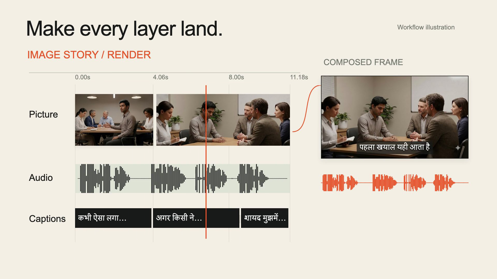

# Video Studio

Two agent-assisted production pipelines for creating story videos: narrated image stories and generated video scenes. Each pipeline installs independently and keeps its own project state, dependencies, and recovery controls.

| Pipeline | Input → output | Production controls |
| --- | --- | --- |
| [Image story](pipelines/image-story/README.md) | Scene narration → timed audio → illustrations/continuations → captioned MP4 | Content fingerprints, dependency checks, durable job state, continuity anchors, writer locks |
| [Generated video](pipelines/generated-video/README.md) | Directed scenes/references → generated clips → human review → MP4 | Hash-bound reviews, archived replacements, continuity frames, accepted-clip render gate |

The creative workflow is agent-guided: writing, direction, visual inspection, and acceptance require judgment. The scripts execute approved inputs; they do not independently publish videos.

## Watch the workflow

[](docs/media/video-studio-showcase.mp4)

The showcase combines animated workflow diagrams with existing KathaMind Hindi output. Picture, narration, and captions align into frames, then separate pipeline exports resolve into MP4 files. [Media attribution and scope](docs/media/README.md).

## Try without an API account

Install Python 3.12, [uv](https://docs.astral.sh/uv/getting-started/installation/), and FFmpeg. Obtain the source checkout:

```bash
git clone https://github.com/Veer376/video-studio.git
cd video-studio
```

Run either example:

```bash
cd pipelines/image-story
uv sync --locked --python 3.12
uv run --locked render-story --project-dir examples/offline --width 640 --height 360 --fps 24
```

Output: `pipelines/image-story/examples/offline/output/final-video-no-bgm.mp4`.

In a separate terminal from the repository root:

```bash
cd pipelines/generated-video
uv sync --locked --python 3.12
uv run --locked python -m scripts.render_video --config examples/offline/scenes.json --output output/offline.mp4
```

Output: `pipelines/generated-video/output/offline.mp4`.

Both fixtures are synthetic test media, including simple tones rather than spoken narration. They demonstrate local rendering and review contracts, not model quality. No credentials or generation calls are needed.

## Create your own production

Follow the owning pipeline README for credentials, editable templates, scene generation, review, and rendering. Direct Google APIs are the primary setup; Flow is an optional separately installed local service.

- [System setup and providers](docs/setup.md)
- [Architecture and state ownership](docs/architecture.md)
- [Recovery and regeneration](docs/recovery.md)
- [Preserved development history](docs/history.md)
- [Validation scope](docs/validation.md)
- [Code and media licensing](docs/licensing.md)

Examples of work produced during development are on [KathaMind Hindi](https://www.youtube.com/@KathaMindHindi). Channel media is separate from the MIT code license.

macOS and Linux are the target platforms. Local macOS installation, offline tests, and both fixture renders have been checked. Linux CI is configured; its first hosted result is pending. Live generation and account/model access have not been tested for this release. Model availability, pricing, quotas, and regional access remain provider requirements.
