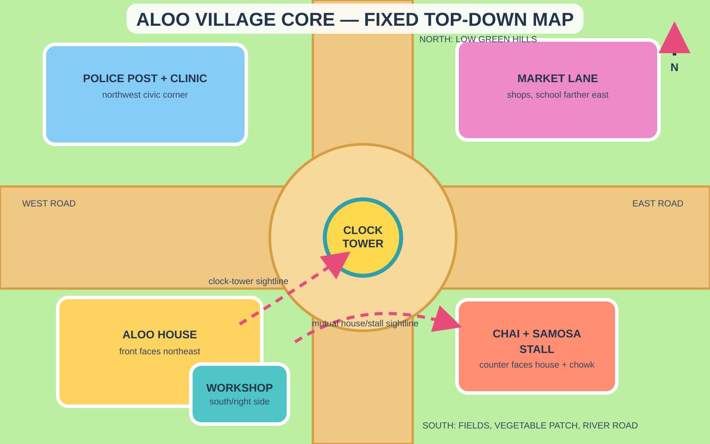

# Aloo Village Core — Location Bible

This is an original fixed location inspired by the readable, compact geography of Indian 3D cartoon towns. It is not a replica of Furfuri Nagar. The source show changes its buildings and spatial relationships between episodes, so this document defines the canon used by this project.

## Canonical generated references

- **Aloopur Central Chowk:** `assets/locations/aloo-village/aloopur-central-chowk.png`
- **Aloo Nivas Living Room:** `assets/locations/aloo-village/aloo-nivas-living-room.png`

Use these exact images as location references in scene generation. The exterior owns village geography; the interior owns the permanent room design and outside sightline.

## Master geography

- The **main road runs west to east** through a small circular village chowk.
- **Aloo House** occupies the southwest corner, facing northeast toward the chowk.
- **Chai and Samosa Stall** sits diagonally opposite the house on the southeast corner, 10–12 metres across the road. Its striped awning is visible from Aloo's veranda and living-room window.
- A large **yellow clock tower with a turquoise roof** stands on the north edge of the chowk. It is the permanent orientation landmark.
- The **market lane** continues east behind the tea stall; the school is farther down this lane.
- The **police post and clinic** sit northwest of the chowk.
- A narrow lane beside Aloo House leads south to its workshop, vegetable patch, fields, and river road.
- Low green hills rise north of the village. Agricultural fields and the river lie south.

## Reference image A — village master wide

Create one elevated 16:9 establishing image viewed from the southwest, looking northeast.

It must show, in one readable composition:

1. Aloo House in the left foreground.
2. The chai stall in the right foreground, diagonally across the road.
3. The circular chowk and clock tower in the middle.
4. Market lane extending behind the stall to the right.
5. Police post and clinic beyond the house on the left.
6. Hills behind the town and a glimpse of fields/river road at the lower-right edge.

This image owns village-scale geography. Do not redesign or relocate buildings in later scenes.

## Reference image B — Aloo House street view

Use a human-eye camera from the chowk, looking southwest at the house. The tea-stall counter or striped awning must remain partially visible at the far-left foreground so the street relationship is encoded.

Fixed exterior:

- one-storey warm mango-yellow plaster house;
- turquoise front door and window frames;
- coral-red clay-tile sloping roof;
- shaded front veranda with two round turquoise columns;
- one broad living-room window to the left of the door;
- low mint-green boundary wall and coral gate;
- workshop/garage attached on the right, opening toward the south lane;
- tulsi planter and two marigold pots in the front courtyard;
- mature guava tree at the rear-left corner.

## Reference image C — Aloo House interior sightline

Two references are not sufficient to lock both village geography and an interior. Generate this third image once and reuse it whenever the story enters the house.

Camera stands at the rear of the living room, looking toward the front door and broad window. Through the openings, show only the correct fragments: the road, the chai stall's striped awning, and the upper portion of the clock tower. Do not show the whole village.

Fixed interior layout:

- living room at the northeast/front of the house;
- kitchen behind it on the southeast, with a courtyard-facing window;
- Aloo's bedroom at the northwest/rear;
- Chhotu's room at the southwest/rear, connected to the workshop;
- rear door between the kitchen and Chhotu's room, opening to the vegetable patch;
- cream walls, aqua trim, coral and sunny-yellow fabrics, light polished wood;
- family sofa/charpai on the west wall, low table in the centre, photo shelf and brass clock on the north wall.

## Chai and Samosa Stall

The stall is a recurring social location, not a separate district.

- Open counter faces northwest toward Aloo House and the chowk.
- Coral-and-cream striped awning; turquoise counter; yellow signboard.
- Samosa fryer and tea boiler remain on the east side of the counter.
- Two benches sit along the road edge without blocking the house sightline.
- Small preparation room behind the counter; market lane passes behind it.

## Non-negotiable continuity checks

- From Aloo's veranda: stall awning and clock-tower roof are visible.
- From the stall: Aloo's turquoise door and veranda are visible.
- From the living-room window: only road, awning, and clock-tower top are visible.
- From the master wide: house is left foreground; stall is right foreground; clock tower is central.
- The workshop always remains on the house's south/right side when facing the facade.
- Preserve the light, vibrant palette. Avoid dark, muddy, or desaturated architecture except for temporary story lighting.
